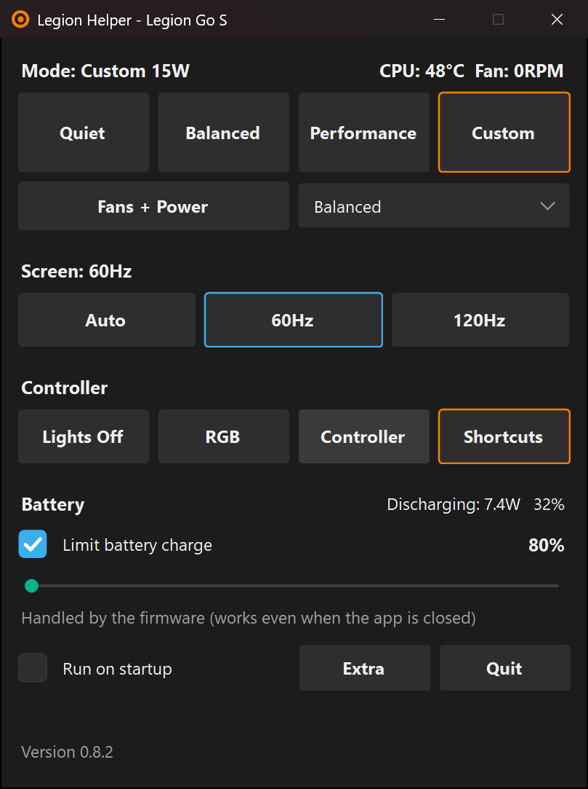
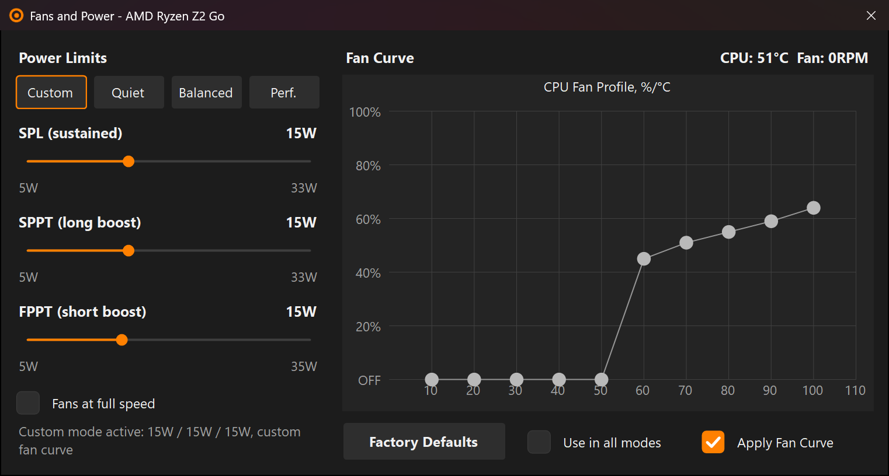
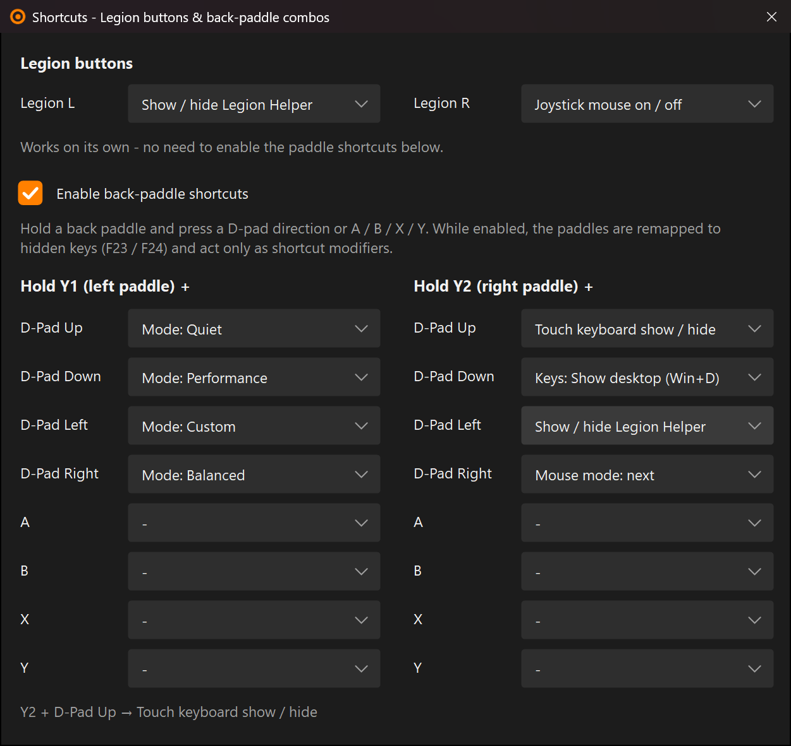
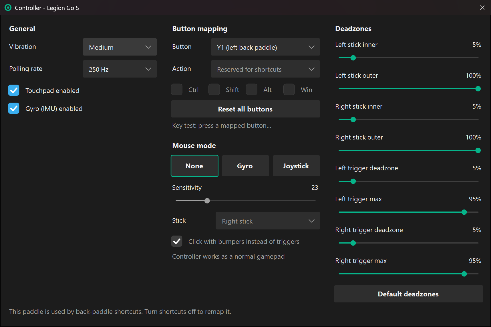
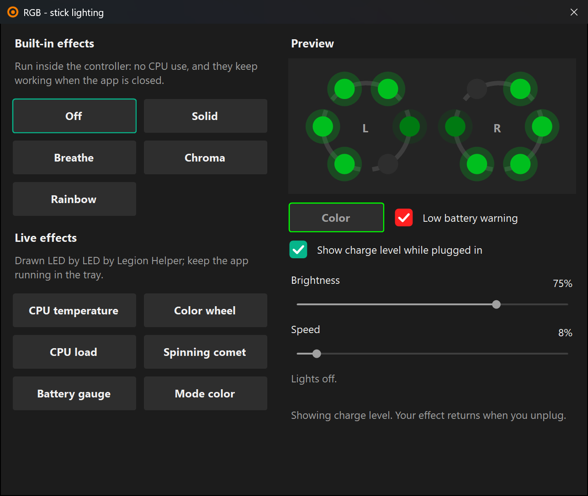
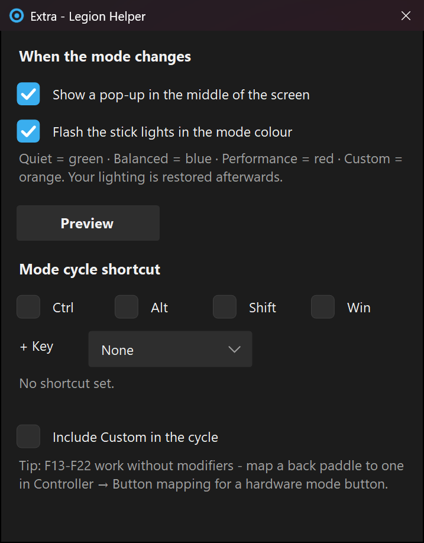

<h1 align="center">Legion Helper</h1>

<p align="center">
  <b>A tiny, offline control app for the Lenovo Legion Go S.</b><br>
  Performance modes, TDP, fan curve, charge limit, RGB, controller remapping and back-paddle shortcuts.<br>
  No launcher, no store, no overlay, no account, no internet.
</p>

<p align="center">
  <a href="../../releases/latest"></a>
</p>

<p align="center">
  
  
  
  
</p>

<p align="center">
  
  &nbsp;
  
</p>

Legion Helper replaces Lenovo Legion Space for the things that matter on a handheld. It is inspired by
[G-Helper](https://github.com/seerge/g-helper) for ASUS devices: one small window that does the job and gets out of the
way.

## Why Legion Helper

| | Legion Space 1.4.9.3 | Legion Helper |
|---|---|---|
| Download | ~467 MB installer | **0.6 MB** single exe, no installer |
| Runs as | Embedded Chromium (~250 MB `libcef.dll`) plus a background service | One small process |
| Internet required | Yes | No, fully offline |

### Resource use

| | Legion Helper in the tray |
|---|---|
| Private memory | ~17 MB (about 30 MB after opening every window) |
| CPU when idle | ~0.25% of the CPU (about 2% of one core) |
| Live per-LED RGB effect | about 1% of one core extra |
| Built-in RGB effects, button mappings, 80% charge limit | 0%, they run in the firmware and keep working when the app is closed |

<sub>Measured on a Legion Go S (Ryzen Z2 Go, 8 threads) with version 0.8.2, back-paddle shortcuts and Legion button
actions on.</sub>

## Download and install

1. Download **`LegionHelper.exe`** from the [latest release](../../releases/latest).
2. Install the [.NET 8 Desktop Runtime (x64)](https://dotnet.microsoft.com/download/dotnet/8.0) if you don't have it.
   Any newer version works too.
3. Put the exe anywhere (for example `C:\Tools\LegionHelper\`) and run it. Windows asks for administrator rights,
   because the Lenovo firmware interface requires them.
4. Optional: tick **Run on startup** in the main window, and **Start hidden in tray**.

**If Legion Space is installed**, quit it and its `LSDaemon` service, or uninstall it, so the two apps don't fight over
the performance mode.

**Uninstall:** untick Run on startup, then delete the exe and the `%AppData%\LegionHelper\` folder (settings and a
small log). Nothing else is installed.

> **Status:** personal project, tested on one Legion Go S (model 83L3 / 8ARP1, Ryzen Z2 Go). Other Legion Go S
> variants will likely work. The original Legion Go has a different controller and is not supported yet.

## Features

### Performance and fans
- **Modes:** Quiet / Balanced / Performance / Custom, one tap each.
  - Stays in sync when the mode is changed by the hardware Legion button or another app.
  - Remembers a separate mode for plugged-in and for battery, and switches automatically.
- **Custom TDP:** SPL (sustained), SPPT (long boost) and FPPT (short boost) sliders. The ranges come from the firmware
  and differ on AC and on battery.
- **Fan curve:** a 10-point draggable curve, plus "Fans at full speed" and factory defaults.
- **Windows power mode:** Best Power Efficiency / Balanced / Best Performance.
- **Live readout:** CPU temperature, fan RPM and battery charge or discharge rate in watts.

The built-in presets have these power limits (as reported by the Go S 8ARP1 firmware):

| Preset | SPL | SPPT | FPPT |
|---|---|---|---|
| Quiet | 7 W | 15 W | 20 W |
| Balanced | 15 W | 25 W | 30 W |
| Performance | 20 W | 32 W | 35 W |

### Display and battery
- **Refresh rate:** Auto (max on AC, 60 Hz on battery) / 60 Hz / 120 Hz.
- **Battery charge limit:** 80 / 85 / 90 / 95%.
  - **80%** is the firmware's own limit and works even when the app is closed.
  - **85-95%** is managed by Legion Helper and holds the level once reached. Turn on **Run on startup** so it
    survives a reboot.

### Back-paddle shortcuts and Legion buttons

<p align="center">
  
</p>

Hold **Y1** or **Y2** and press a D-pad direction or **A / B / X / Y**. That gives 16 combinations, each with its own
action. The two Lenovo buttons, **Legion L** and **Legion R**, can run an action too, even with paddle shortcuts off.

Available actions:
- **Mode:** Quiet / Balanced / Performance / Custom, or next mode.
- **Mouse mode:** None / Gyro / Joystick, next mouse mode, joystick or gyro mouse on/off, gyro calibration.
- **Touch keyboard show / hide:** the Windows touch keyboard used on tablets, which has no hotkey of its own.
- **Keys:** Task Manager, Alt+Tab, Alt+F4, show desktop, Task view, Game Bar, record clip, Snip, screenshot,
  on-screen keyboard, volume and media keys, or any single key including F13-F22.
- **Other:** lights on/off, 60/120 Hz, show/hide Legion Helper, charge limit on/off.

While shortcuts are on, the paddles act only as shortcut modifiers. The D-pad or face-button press is still seen by
the game.

### Controller

<p align="center">
  
</p>

- **General:** vibration strength, polling rate (125-1000 Hz), touchpad and gyro on/off.
- **Deadzones:** inner/outer for each stick, deadzone/max for each trigger.
- **Button remapping:** back paddles, face buttons, bumpers, triggers, stick clicks, D-pad and View/Menu can send any
  gamepad button, keyboard key (including hidden F13-F24), key combination, mouse button, wheel or media key.
  Mappings are stored in the controller, so they work without the app. A built-in key tester shows what a button
  sends.
- **Mouse mode** for the desktop:
  - **Joystick:** one stick moves the cursor, the other scrolls, triggers (or bumpers) click.
  - **Gyro:** tilt the device to move the cursor. Drift-free, with automatic calibration.

### RGB stick lights

<p align="center">
  
</p>

- **Built-in effects:** Off / Solid / Breathe / Chroma / Rainbow. They run inside the controller, use no CPU and keep
  working without the app.
- **Live per-LED effects:** CPU temperature colour, CPU load gauge, battery gauge, spinning comet, colour wheel and mode
  colour. They are drawn LED by LED and cost about 1% of one core.
- **Low-battery warning:** a red pulse at 15% or less, on top of any live effect.
- **Charge level while plugged in (optional):** while the charger is connected, the sticks show the battery gauge with
  the segment being charged pulsing, solid green when full. Unplug to get your effect back.
  - It is drawn by the app, so it stops while the console sleeps. On the Legion Go S (Modern Standby) turning the
    screen off also puts the console to sleep, so to keep it showing, set Windows' "When plugged in, turn my screen
    off after" to Never and don't press the power button.
- The window warns when Windows Dynamic Lighting is on and could override the lights.

### Quality of life

<p align="center">
  
</p>

- **Mode feedback:** a centred pop-up when the mode changes (visible over borderless and windowed games), and an
  optional flash of the stick lights in the mode colour: Quiet green, Balanced blue, Performance red, Custom orange.
- **Mode-cycle shortcut:** a key combination such as Ctrl + Alt + M, or a lone F13-F22 key. Map a back paddle to it
  for a hardware mode button.
- **Tray icon** coloured by mode, with a right-click menu.
- **Run on startup** with an optional start hidden in the tray. Settings are re-applied after sleep.
- Dark UI with sharp per-monitor DPI scaling.

## Command line

| Command | Effect |
|---|---|
| `LegionHelper.exe` | Open the main window |
| `LegionHelper.exe -tray` | Start hidden in the tray |
| `LegionHelper.exe -fans` | Open Fans and Power |
| `LegionHelper.exe -controller` | Open Controller settings |
| `LegionHelper.exe -rgb` | Open the RGB window |

Closing a window hides it to the tray. Use **Quit** or the tray menu to exit.

## Known limitations
- **Charge limit:** the firmware's only charge control is "stop at 80%", the same as in Legion Space. 85-95% is
  emulated by Legion Helper and needs it running. Limits below 80% aren't possible.
- **Exclusive fullscreen:** the mode pop-up can't draw over games running in exclusive fullscreen (same as G-Helper).
- **Legion L / Legion R** can't be remapped; the controller rejects it. They can run Legion Helper actions instead.
- **RGB rings:** lamp N drives one LED on each ring, so the right ring always mirrors the left rotated 180°.
- **Per-LED effects** make Steam briefly show the controller disconnecting and reconnecting when they start or stop.
  This is firmware behaviour.
- **Gyro mouse** is done in software, because the firmware's own gyro-mouse mode drifts.

---

## For developers

### Build
Requires the [.NET 8 SDK](https://dotnet.microsoft.com/download/dotnet/8.0).

```powershell
cd app
dotnet publish -c Release -o ..\dist
```

The output is a single framework-dependent `dist\LegionHelper.exe`. Release builds contain no debug symbols or local
paths. Release and testing notes are in [`docs/DEVELOPMENT.md`](docs/DEVELOPMENT.md).

### How it works
Legion Helper talks to the same hardware interfaces as Legion Space. They were found by analysing the Legion Space
installer and then verified on the device:

- [`docs/hardware-interface.md`](docs/hardware-interface.md): the Lenovo Gaming Zone WMI interface (`root\WMI`).
  Performance modes, power-limit and feature IDs, the fan-table layout, the charge limit and sensors.
- [`docs/controller-protocol.md`](docs/controller-protocol.md): the controller's vendor HID protocol (`1A86:E310`,
  usage page `0xFFA0`). Settings, RGB, per-LED LampArray, deadzones, button remapping with key, mouse and media codes,
  gyro and the state stream used for Legion L/R.
- [`docs/reverse-engineering.md`](docs/reverse-engineering.md): how the interfaces were found, so others can extend
  support.

A few implementation details:
- The firmware's own temperature calls return 0, so the CPU temperature comes from a separate firmware sensor ID.
- The back paddles aren't visible to XInput. While shortcuts are on, they are remapped in the controller to hidden keys
  (F23/F24), which a low-level keyboard hook intercepts. XInput is polled only while a paddle is held.
- Legion L/R send nothing to Windows. Their presses are read from the controller's state stream (`mi_06`).
- The Windows touch keyboard is toggled through the `ITipInvocation` COM interface of `TabTip.exe`, the same mechanism
  the taskbar keyboard button uses.
- Live RGB effects start at 7 o'clock on the left stick, the first LED after the gap at the bottom, so gauges fill
  the ring one plastic sector at a time.

No Lenovo code or binaries are included in this repository.

### Source layout
```
app/
  Program.cs                 entry point, single instance, startup flags
  MainForm.cs                main window, tray, hotkey, mode feedback, shortcut actions
  FansForm.cs                TDP sliders and fan curve
  ControllerForm.cs          controller settings, mouse modes
  ExtraForm.cs               mode pop-up / light flash / cycle hotkey
  ShortcutsForm.cs           back-paddle combos and Legion L/R actions
  Shortcuts.cs               action list, key sending, touch keyboard toggle
  RgbForm.cs, Lighting.cs    RGB window and effect engine (built-in + live per-LED effects)
  ModeControl.cs             applies and re-applies modes, limits, fan curve, AC/battery switching
  Config.cs                  settings (%AppData%\LegionHelper\config.json)
  Feedback.cs                on-screen pop-up, RGB flash
  Assets/app.ico             app icon (generated by Assets/make-icon.ps1)
  Hardware/LenovoWmi.cs      firmware WMI interface
  Hardware/LegionController.cs  controller HID protocol
  Hardware/LampArray.cs      per-LED control via the controller's HID LampArray
  Hardware/PaddleChords.cs   paddle (F23/F24) hook + XInput chord detection
  Hardware/ControllerState.cs  reads Legion L/R presses from the controller state stream (mi_06)
  Hardware/KeyCatalog.cs     button ids and mapping targets
  Hardware/JoystickMouse.cs  joystick-as-mouse (XInput)
  Hardware/GyroMouse.cs      gyro-as-mouse (Windows Sensor API)
  Hardware/SystemControl.cs  refresh rate, Windows power mode, startup task, battery
  UI/Controls.cs             themed button, dropdown, checkbox, slider, fan-curve chart
docs/                        protocol notes, development notes and screenshots
```

## Credits
- [G-Helper](https://github.com/seerge/g-helper) by seerge, for the concept and UI design. Its UI controls were the
  model for this app's dark theme.
- The Linux kernel driver `drivers/hid/hid-lenovo-go-s.c`, used to cross-check controller command names and the RGB
  layout.

## Disclaimer
This is an independent project. It is not affiliated with, endorsed by, or supported by Lenovo. "Lenovo", "Legion"
and "Legion Space" are trademarks of Lenovo. The app changes power limits, fan behaviour and controller firmware
settings within the ranges the firmware reports. Use it at your own risk.

## License
[GPL-3.0](LICENSE), the same as G-Helper.
