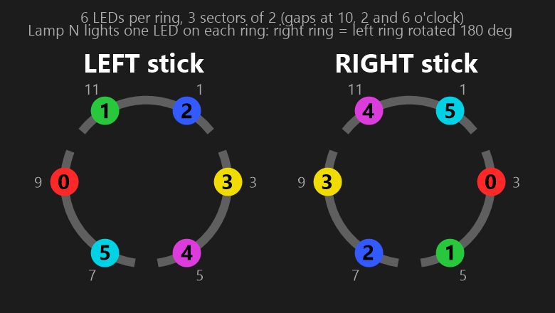

# Legion Go S controller protocol

Built-in controller: USB **1A86:E310** (XInput) / **E311** (DInput). This is the Huaqin MCU.

| Source | Use |
|---|---|
| Legion Space `HuaqinUsb\LEGOQHWHandle.dll` | Disassembly of its 146 exports; primary source |
| Linux `drivers/hid/hid-lenovo-go-s.c` | Cross-check for names |
| This device | Every value marked ✔ was write/read-back tested and then restored |

## Transport
- Open the HID interface with **usage page `0xFFA0`** and 65-byte output reports. On this unit that is `MI_03`.
- Output report: `[0x00 (report id), cmd, sub, data…]`, zero-padded to 65 bytes.
- Reply on the same interface: `[0x00, cmd, sub, payload…]`.
  - Get commands return the value(s) in the payload.
  - Set commands return a status byte, `0` = OK.
- Read with **one continuous reader**. If you leave a second overlapped read pending, it steals the reply.
- Replies arrive within a few ms. Only send one command at a time.

## Commands (get = odd, set = get + 1)

| Get / Set | Sub | Meaning | Values |
|---|---|---|---|
| `03` / `04` | `01` | Gamepad mode | 0 = XInput, … |
| | `04` | Auto sleep time | |
| | `05` | IMU bypass ("gyro direct") | |
| | `06` | RGB enable ✔ | 0/1 |
| | `07` | IMU (gyro) enable | 0/1 |
| | `08` | Touchpad enable | 0/1 |
| | `10` | Polling rate | 0 = 125, 1 = 250, 2 = 500, 3 = 1000 Hz |
| | `20` / `21` | Gamepad / gyro "heartbeat" variants | |
| `05` / `06` | `01` | Touchpad DPI (u16 LE) | read 800 |
| | `02` | Touchpad DPI base | read 400 |
| `07` / `08` | `01` | Vibration strength ✔ | 0 off … 3 strong (read 2) |
| | `03` | Touchpad haptics | 0/1 |
| | `04` | Vibration notify | 0/1 |
| `09` / `0A` | `01`, `02` | Trigger L/R `[deadzone, max]` % ✔ | default 5 / 95 |
| `0B` / `0C` | `01`, `02` | Stick L/R `[inner, outer]` % ✔ | default 5 / 100 |
| | `22`, `23`, `24` | Joystick-as-mouse sensitivity, upload, mode | |
| `0D` / `0E` | `01` | Gyro mapping status | 0 off. On device: **1** drifts constantly (it doesn't correct the IMU's large bias, ≈ -9/7/11 °/s); **2** has no visible effect. Legion Helper keeps this at 0 and implements gyro-mouse in software via the IMU's Windows gyrometer (`HID\VID_1A86&PID_E310&MI_05`, ~100 Hz, Sensor API) with bias calibration |
| | `02` | Gyro-as-mouse `[srcX, srcY, sensX, sensY]` | read `01 02 1E 1E` |
| | `03` | Gyro-as-joystick (9 bytes) | read `01 02 00 32 32 01 01 00 00` |
| | `08`+ | Gyro axis inversion | |
| `0B` / `0C` | `24` / `22` | Joystick-as-mouse mode / sensitivity (unused by Legion Space on the Go S) | read 0 / 10 |
| `0F` / `10` | `01` | RGB mode | 0 = dynamic, 1 = custom |
| | `02` | Active profile | 1-3 |
| | `03`-`05` | Profile 1-3 `[effect, R, G, B, brightness 0-100, speed 0-100]` ✔ | |
| `11` / `12` | `01` / `04` / `05` | Button remap (see below) ✔ | |
| | `02` | Turbo per-button | |
| | `06` | Legion L/R + menu/view behaviour | |
| | `10` | Turbo enable | |
| `01` | | Get firmware version | |

RGB effects: 0 solid, 1 breathe, 2 chroma, 3 rainbow.

To change the lighting:
1. Write profile 1: `10 03 …`.
2. Select custom mode: `10 01 01`.
3. Activate profile 1: `10 02 01`.
4. Enable the rings: `04 06 01`.

In this "custom" mode both rings show **one** colour or effect.
- The profile is exactly 6 bytes; extra bytes are dropped.
- Effect values above 3 are rejected.
- Only sub-commands `01`-`05` exist under `0F`/`10`.
- Updates are fast: about 2.3 ms each (~430 per second), and colours snap with no fade.

## Per-LED lighting (Windows Dynamic Lighting / HID LampArray) ✔

Writing **`10 01 00`** (RGB mode 0, "dynamic") makes the controller re-enumerate. Interface **`mi_04`** turns into a
standard **HID LampArray** (usage page `0x59`), which is the device class behind Windows 11 Dynamic Lighting. Windows
then offers its Dynamic Lighting settings. `10 01 01` switches back to the normal vendor mode.

**Requirement:** the RGB master switch (`04 06 01`) must be on, or every LampArray update is accepted but the LEDs
stay dark.

### Attributes (feature report 1)

| Field | Value |
|---|---|
| LampCount | **6** |
| LampArrayKind | 3 (game controller) |
| Bounding box | 32 × 32 × 0.1 mm |
| MinUpdateInterval | 10 ms |

Every lamp is programmable, with 255 levels each of red, green and blue. The positions the device reports are a generic
3×2 grid (x = 10.5 / 29.5 / 48.5 mm, y = 30 / 49.5 mm) and do **not** reflect the physical layout.

### Report IDs (all feature reports)

| ID | Report | Contents |
|---|---|---|
| 1 | LampArrayAttributes | `0x03`-`0x08` |
| 2 | LampAttributesRequest | LampId `0x21` |
| 3 | LampAttributesResponse | `0x21`, `0x23`-`0x2C` |
| 4 | LampMultiUpdate | flags `0x55`, count `0x03`, 8 × LampId `0x21`, 8 × RGBI `0x51`-`0x54` |
| 5 | LampRangeUpdate | flags `0x55`, LampIdStart `0x61`, LampIdEnd `0x62`, RGBI `0x51`-`0x54` |
| 6 | LampArrayControl | AutonomousMode `0x71`: 0 = host controls the lamps, 1 = device/default |

### Physical layout (mapped on the device)

Each ring has **6 LEDs in 3 sectors of 2**, with gaps at 10, 2 and 6 o'clock. There are 12 LEDs in total, but only 6
channels: **lamp N drives one LED on each ring**, and the right ring is the left ring **rotated 180°**.

| Lamp | Left ring (clock) | Right ring (clock) |
|---|---|---|
| 0 | 9 | 3 |
| 1 | 11 | 5 |
| 2 | 1 | 7 |
| 3 | 3 | 9 |
| 4 | 5 | 11 |
| 5 | 7 | 1 |

Lamps 0→5 run clockwise on both rings: from 9 o'clock on the left, from 3 o'clock on the right.

**What follows from this:**
- **Possible:** per-segment colours, spinning or chasing effects (both rings turn the same way), 6-step gauges, and
  gradients.
- **Not possible:** different content on the left and right rings.

## Controller state stream (mi_06) ✔

`mi_06` (vendor page `0xFFA0`, 33-byte input reports) streams the controller state at about 100 Hz. Buttons that
never reach Windows as input show up here. That includes **Legion L** and **Legion R**, which can't be remapped:
writing a mapping for them returns status 1.

| Byte | Meaning |
|---|---|
| 1 | bit 0 = **Legion L**, bit 1 = **Legion R** (held = set) |
| 3 | `0x40` = View, `0x80` = Menu |
| 15-26 | IMU (gyro/accelerometer) data |

Legion Helper reads this stream (read-only, shared) to run user-assigned actions on Legion L / R. This was
**confirmed on the device**: presses trigger the assigned actions immediately.

**Why this is the best possible approach (final):**

| Option | Result |
|---|---|
| Remap in firmware (`12 04` + `12 05`) | **Rejected** by the controller (status 1). Legion L/R are fixed system buttons |
| Keyboard / XInput / consumer-control events | **None.** A press produces no Windows input at all, so a hook or hotkey can't see it |
| Other vendor interfaces (`mi_03`, `mi_04`, `mi_02` col04) | **Silent** for these buttons |
| "Switch Button Layout" (`12 06`) | Only swaps their position with View/Menu; adds no new capability |
| **State stream `mi_06`, byte 1** | **The only signal.** It's what Legion Space itself uses. Read-only, shared, about 100 Hz, no side effects on games |

Since the buttons never reach Windows as input, they can only trigger app actions. They can't be turned into
keyboard keys that other programs see, unless an app re-sends keys. Legion Helper does that with its "Keys: …"
actions. "Switch Button
Layout" (`12 06`: 1 = normal, 2 = swapped) makes the firmware swap View ↔ Legion L and Menu ↔ Legion R.

## Button remapping ✔

### Commands
- `11 04 <button>` reads one entry.
- `11 01` returns the whole map in 4 reports: `[page, count, entries…]`, 28 entries in all.
- `12 04 <entry>` writes one entry. **Then send `12 05` to commit.** Without the commit the write is
  acknowledged but has no effect.

### Entry format (7 bytes)
`[button, 0x80 | type, code1 … code5]`

| Type | Target | Codes |
|---|---|---|
| 0 | Keyboard | HID usage |
| 1 | Key combination | Up to 5 HID usages |
| 2 | Gamepad button | Lenovo button id |
| 3 | Mouse | 1 L, 2 R, 3 M, 4 wheel up, 5 wheel down, 6 back, 7 forward |
| 4 | Media | HID consumer usage: CD play/pause, B5 next, B6 prev, B7 stop |

The default for a button is `[id, 0x82, id]`. Legion L/R (`01`/`02`) are stored as `[id, 0x00, …]`, and
**writes to them are rejected** (status 1).

### Button ids
These come from Legion Space's `LRH_*` table:

| Id | Button | Id | Button | Id | Button |
|---|---|---|---|---|---|
| 01 | Legion L | 12 | A | 1C | Y1 (left back) |
| 02 | Legion R | 13 | B | 1D | Y2 (right back) |
| 03 | Left stick press | 14 | X | 23 | View |
| 08 | Right stick press | 15 | Y | 24 | Menu |
| 0D | D-pad up | 16 | LB | | |
| 0E | D-pad down | 17 | LT | | |
| 0F | D-pad left | 18 | RB | | |
| 10 | D-pad right | 19 | RT | | |

### Keyboard codes
Keyboard codes are standard HID usages. Lenovo's VK→HID table is in `app/Hardware/KeyCatalog.cs`.

Lenovo's table stops at F12, but the controller also accepts **F13-F24** (HID `0x68`-`0x73`). I verified this by
write/read-back, and a physical press of an F13+ mapping was confirmed on the device. The Controller window
has a key tester for checking presses.

Settings persist in the controller MCU. They don't need to be re-applied at boot.
